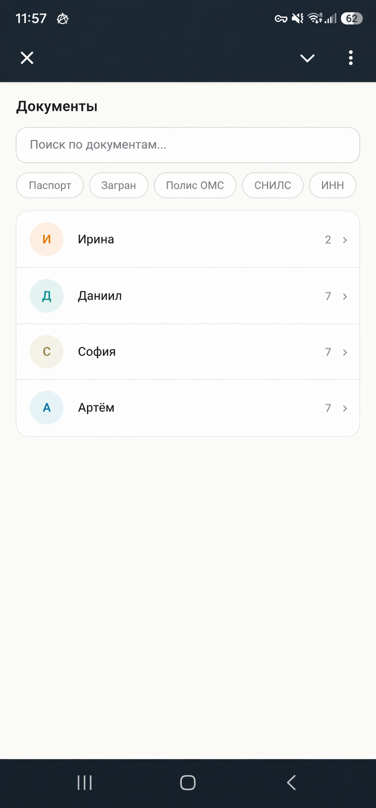
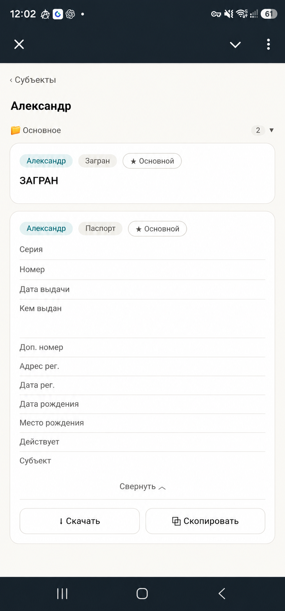
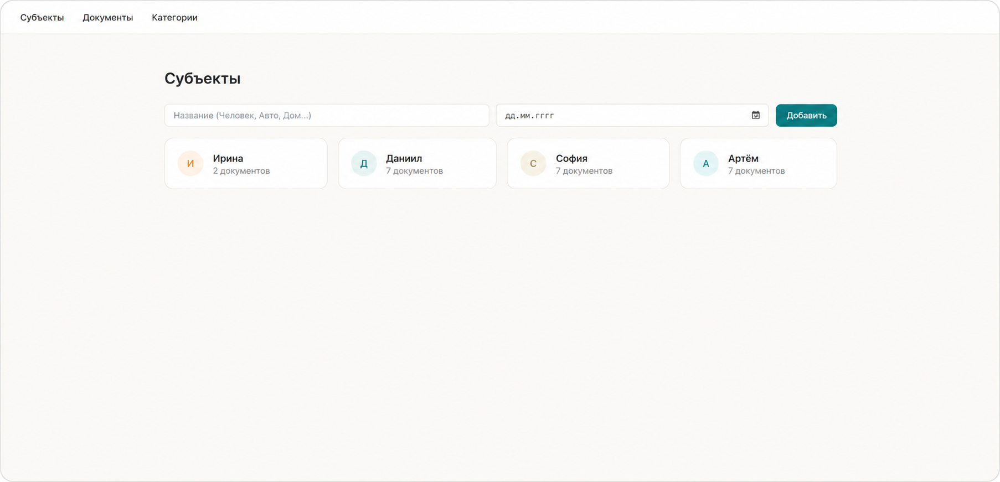
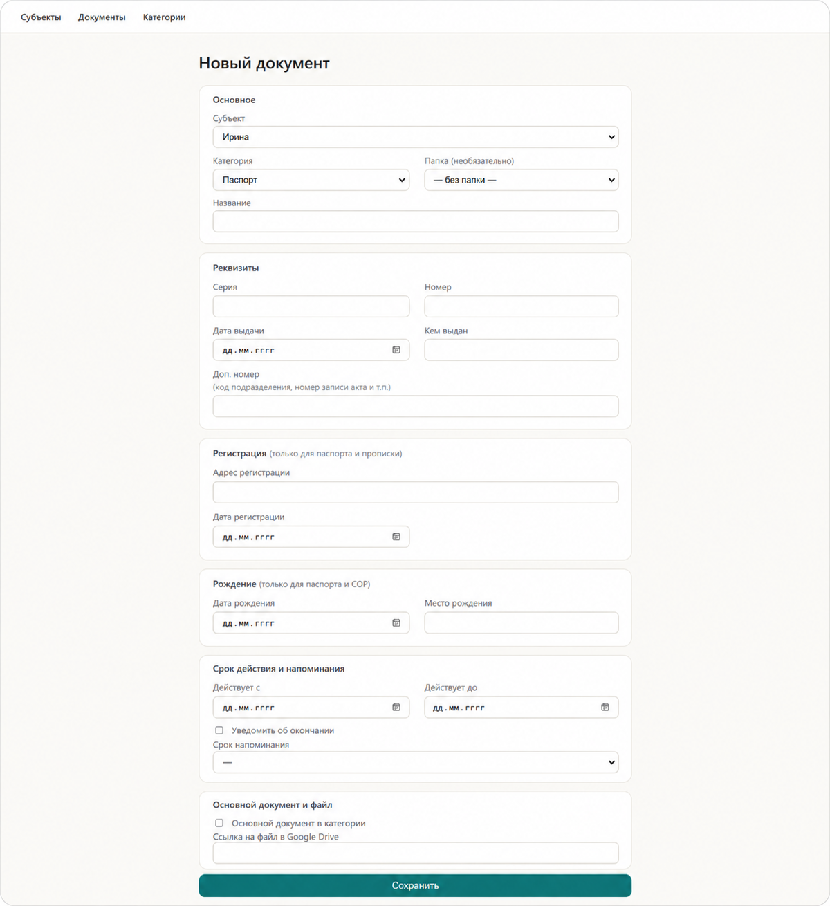
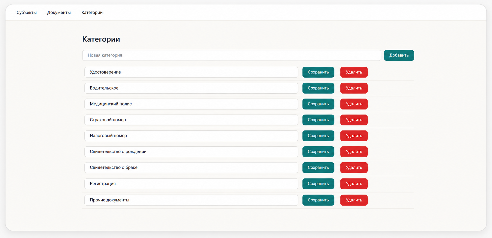
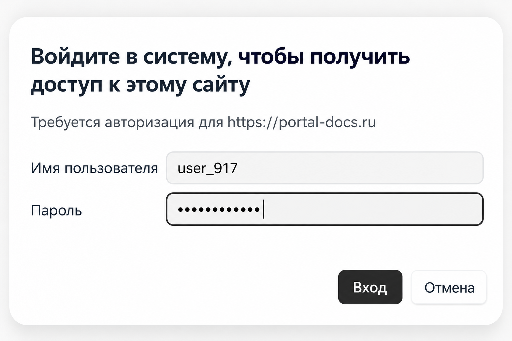

# DoxBox — хранилище документов в Telegram

Личное хранилище семейных документов: паспорта, загранпаспорта, СНИЛС, ИНН, полисы, свидетельства. Просмотр и скачивание — в Telegram Mini App, заполнение — через веб-админку. Сами сканы лежат в Google Drive, приложение хранит реквизиты и ссылки на файлы.

Проект в эксплуатации: развёрнут на VPS через Docker Compose за nginx с HTTPS.



## Возможности

**Telegram Mini App (только чтение)**
- Список субъектов (люди, авто, объекты) с количеством документов
- Поиск по названию, серии, номеру и «кем выдан», фильтры по субъекту и категории, режим «только основные»
- Карточка документа: реквизиты, регистрация, данные о рождении, срок действия; копирование в один тап
- Скачивание файла: бот присылает копию документа прямо в чат с понятным именем («Паспорт Иван.pdf» вместо имени от сканера)

**Веб-админка**
- Субъекты, папки внутри субъекта, собственные категории документов
- Реквизиты: серия, номер, дата выдачи, кем выдан, доп. номер, адрес и дата регистрации, дата и место рождения, срок действия
- Пометка «основной документ в категории»
- Правка отдельных полей прямо в карточке документа
- Ссылка на файл в Google Drive — ID файла извлекается автоматически
- Нельзя удалить субъект или категорию, пока на них ссылаются документы

**Бэкапы**
- Снимок базы через `VACUUM INTO` (целостный даже при параллельной записи) раз в неделю (вс, 03:00) и при каждом старте
- Снимок перезаписывает заранее созданный файл в Google Drive, история версий — средствами Drive

## Безопасность

- **Mini App:** каждый запрос к API проверяется по подписи Telegram `initData` (HMAC-SHA256 от токена бота), initData старше суток отклоняется
- **Белый список:** доступ только для Telegram ID из `ALLOWED_TELEGRAM_IDS`
- **Файлы:** отдаются по подписанной ссылке, привязанной к конкретному документу и живущей 5 минут; файл стримится из Google Drive через бэкенд, сама ссылка на Drive наружу не уходит
- **Админка:** закрыта Basic Auth на уровне nginx (настраивается при деплое, в коде приложения её нет)
- **Секреты:** токен бота, ключ сервисного аккаунта Google и база исключены из репозитория
- **HTTPS:** Let's Encrypt; Telegram не открывает Mini App по http

## Стек

Python · FastAPI · SQLAlchemy 2 · SQLite · aiogram 3 · Telegram Mini App (HTML/JS) · Jinja2 · Google Drive API (сервисный аккаунт) · APScheduler · httpx · Docker Compose · nginx

## Структура

| Путь | Назначение |
|---|---|
| `main.py` | FastAPI: веб-админка, отдача файлов по подписанной ссылке, планировщик бэкапов |
| `api.py` | JSON API для Mini App (`/api/*`), отправка файла в чат через Bot API |
| `bot.py` | Telegram-бот: `/start` и кнопка открытия Mini App |
| `telegram_auth.py` | Проверка `initData` и белого списка |
| `download_tokens.py` | Подписанные временные ссылки на скачивание |
| `drive.py` | Google Drive API: метаданные, потоковая отдача, перезапись файла бэкапа |
| `models.py`, `database.py` | Модели, инициализация БД и лёгкие миграции |
| `static/miniapp/` | Фронтенд Mini App |
| `templates/` | Шаблоны админки |
| `SPEC.md` | Спецификация проекта |

## Запуск

1. Скопировать `.env.example` в `.env` и заполнить:
   - `BOT_TOKEN` — токен бота от @BotFather
   - `WEBAPP_URL` — https-адрес Mini App
   - `ALLOWED_TELEGRAM_IDS` — Telegram ID через запятую (бот показывает ID в ответ на `/start`)
   - `DEV_MODE=false` — на проде обязательно
   - `DOWNLOAD_TOKEN_SECRET` — случайная строка для подписи ссылок
   - `BACKUP_FILE_ID` — ID файла в Google Drive для бэкапа (необязательно)
2. Положить ключ сервисного аккаунта Google в `service_account.json` и выдать ему доступ к папке со сканами.
3. Запустить:

```bash
docker compose up -d --build
```

Поднимаются два контейнера: `backend` (FastAPI на `127.0.0.1:8010`) и `bot` (aiogram, polling). Снаружи бэкенд публикуется через nginx с HTTPS, `/admin` закрывается Basic Auth.

## Скриншоты

| Mini App | Карточка документа |
|---|---|
|  |  |

**Админка: субъекты**


**Админка: новый документ**


**Админка: категории**


**Вход в админку**


*На скриншотах демо-данные.*

## В планах

- Напоминания в Telegram об окончании срока действия документов (поля срока и настройки напоминания уже есть в модели и форме)
